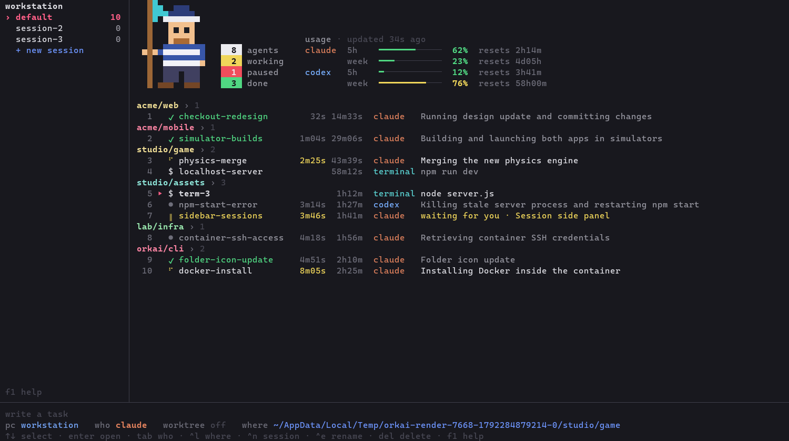

# orkai

Um terminal para orquestrar vários agentes de IA (Claude Code, Codex) e terminais comuns,
em vários projetos ao mesmo tempo, organizados em sessões. Binário único, nativo, sem runtime,
para Windows, Linux e macOS.



## Instalação

Baixe o binário da sua plataforma na release
[`latest`](https://github.com/lucasmarujo/orkai-cli/releases/tag/latest), renomeie para
`orkai` (`orkai.exe` no Windows) e coloque numa pasta do `PATH`:

| Plataforma | Arquivo |
| --- | --- |
| Windows x64 | `orkai-x86_64-pc-windows-msvc.exe` |
| Linux x64 (estático, qualquer distro) | `orkai-x86_64-unknown-linux-musl` |
| macOS Apple Silicon | `orkai-aarch64-apple-darwin` |
| macOS Intel | `orkai-x86_64-apple-darwin` |

Ou compile com Rust 1.88+: `cargo install --path .` (vai para `~/.cargo/bin`).
Depois é só digitar `orkai` no PowerShell, Bash ou zsh.

Para usar agentes de IA, `claude` e/ou `codex` precisam estar no `PATH`.

## Atualização automática

Cada push no `main` passa pelos testes nos três sistemas e vira uma nova build na release
`latest`, com um `manifest.json` contendo o commit e o SHA-256 de cada binário.

Toda vez que você abre `orkai`, ele consulta esse manifesto (timeout curto; sem internet,
abre direto). Se houver uma build mais nova, ele baixa o binário da sua plataforma, confere
tamanho e SHA-256, substitui o próprio executável e abre já atualizado. Os agentes em
execução não são afetados, porque rodam de cópias próprias do binário.

- `orkai update` atualiza na hora (também converte uma build local em build oficial);
- `orkai --version` mostra a versão e o commit (`dev` para builds locais, que não se
  auto-atualizam);
- `ORKAI_NO_UPDATE=1` desliga a verificação; `ORKAI_UPDATE_URL` aponta para outro
  servidor de builds.

## Uso

```
orkai
```

| Área | O que mostra |
| --- | --- |
| Lateral | máquina, sessões com o número de agentes ativos em cada uma, `+ new session` |
| Topo | o homenzinho pixelado, os contadores `agents`, `working`, `paused` e `done` da sessão e, à direita, o consumo do Claude Code e do Codex (veja abaixo) |
| Lista | agentes agrupados por pasta (com a contagem de cada uma): número, estado, nome, tempo no estado atual, tempo de vida, tipo (`claude`, `codex`, `terminal`) e a frase do que o agente está fazendo; logo abaixo de cada agente, os subagents que ele disparou e ainda estão rodando (`↳`, tipo, há quanto tempo, descrição e a ferramenta em uso) |
| Rodapé | `write a task`, `pc`, `who`, `worktree` e `where` para lançar novos agentes |

Estados: `⠋` trabalhando · `‖` em amarelo, esperando você responder (aprovação, pergunta ou escolha dentro do agente) · `✔` terminou (ainda não visto) ·
`●` ocioso · `$` terminal · `↻` interrompido (crash/reboot) · `✗` encerrado.

Um terminal em que você roda `claude` ou `codex` vira esse agente sozinho: em até 2 segundos o
overview passa a mostrar o tipo, o estado (trabalhando, esperando você, terminou), os subagents e os
contadores como os de um agente lançado pelo orkai. Ao sair do `claude`/`codex`, volta a ser `terminal`.

### Estado exato pelos hooks

Ao lançar o Claude Code (2.1.78 ou mais novo), o orkai passa um `--settings` com hooks assíncronos, que não
atrasam o agente. Eles avisam o orkai quando você envia uma tarefa, quando o agente usa uma ferramenta, pede
permissão ou faz uma pergunta, e quando o turno termina. Assim o estado muda na hora, sem depender do texto
da tela; por exemplo, uma resposta final que termina com "Would you like to…?" não vira mais `‖`. No Codex,
o orkai usa o `notify` para saber quando o turno termina.

- Os hooks somam-se aos seus (do usuário, do projeto e dos plugins), sem substituí-los. Se você já passa
  `--settings` em `claude_args`, ou já tem um `notify` no `config.toml` do Codex, o orkai não mexe.
- Cada hook só grava o tipo do evento e a hora num arquivo dentro da pasta do agente; o prompt, os comandos e
  as respostas nunca são gravados em disco.
- A leitura da tela continua como reserva: para agentes iniciados antes desta versão, versões antigas do
  Claude Code, interrupções com `esc`, diálogos sem hook (como o de confiar na pasta) e, no Windows, quando
  não há Git Bash (os hooks do Claude Code rodam nele).

### Avisos

Quando um agente que você não está olhando passa a esperar você (`‖`) ou termina (`✔`):

- o terminal toca o sino (no Windows Terminal, a barra de tarefas pisca) e recebe uma notificação de
  área de trabalho (OSC 9, mostrada pelo iTerm2, WezTerm, Ghostty, kitty e outros);
- o rodapé avisa `<agente> is waiting for you · alt+n opens it`;
- o título da janela mostra quantos estão esperando e quantos terminaram, em todas as sessões
  (`‖2 ✔1 · Orkai`), visível na barra de tarefas mesmo com o orkai em segundo plano.

`alt+n` (no overview ou dentro de qualquer aba) abre o agente que espera há mais tempo; os que
terminaram vêm depois. Dentro de uma aba, a barra de baixo mostra quantos outros precisam de você.
Abrir o agente marca como visto. Um mesmo agente não toca de novo pelo mesmo motivo em menos de 15 s.

Para receber o aviso em outro lugar (celular, notificação nativa do sistema), configure
`notify_command` (veja [Configuração](#configuração)). O comando roda a cada aviso, sem shell, com
estas variáveis de ambiente: `ORKAI_MESSAGE`, `ORKAI_AGENT_ID`, `ORKAI_AGENT_NAME`, `ORKAI_AGENT_KIND`,
`ORKAI_AGENT_STATE` (`paused` ou `done`), `ORKAI_SESSION`, `ORKAI_AGENT_CWD` e `ORKAI_AGENT_ACTIVITY`
(a frase do que o agente está fazendo). Ele é encerrado se passar de 30 s.

### Consumo do Claude Code e do Codex

À direita dos contadores, o overview mostra quanto já foi usado da janela de 5 horas (`5h`) e da
semanal (`week`) de cada plano, com uma barra (verde, amarela a partir de 70%, vermelha a partir de
90%) e a contagem regressiva até o reset. Os valores são consultados a cada 2 minutos, em segundo
plano, com o login que o próprio `claude` e o `codex` já guardam na máquina:

- **Claude Code**: `~/.claude/.credentials.json` (ou `CLAUDE_CONFIG_DIR`; no macOS, o Keychain);
- **Codex**: `~/.codex/auth.json` (ou `CODEX_HOME`), com login do ChatGPT.

Sem login aparece `not signed in`; com o login vencido, `login expired` (abrir o agente renova); e
se a consulta falhar, o último valor continua na tela com `unavailable`.

### Teclas

| Tecla | Ação |
| --- | --- |
| digitar + `enter` | inicia um agente com a tarefa digitada |
| `!comando` + `enter` | roda o comando num terminal novo, sem mudar o `who` (ex.: `!npm run dev`) |
| `shift+enter` (ou `alt+enter`) | quebra de linha na tarefa, sem enviar; colar um texto com várias linhas também mantém as quebras |
| `tab` / `shift+tab` | escolhe quem executa: claude, codex ou terminal |
| `/where <pasta>` ou `ctrl+l` | escolhe a pasta da sessão (veja abaixo); clicar no nome de um projeto também |
| `↑` `↓` / mouse | seleciona; `enter` ou clique abre o agente numa aba |
| `ctrl+]` | sai da aba do agente e volta para a visão geral |
| `shift+pgup` / roda do mouse | histórico do agente |
| `alt+1..9` | pula para uma aba aberta |
| `alt+n` | abre o próximo agente esperando você (ou que terminou), de qualquer tela |
| `ctrl+e` / `f2` | renomeia o agente |
| `ctrl+t` | liga/desliga a worktree própria para os próximos agentes (veja abaixo) |
| `delete` | para e remove o agente selecionado (com o texto vazio), após confirmar no popup |
| `ctrl+x` | encerra um agente em execução / remove um encerrado (também pede confirmação no popup) |
| `ctrl+r` | recupera os agentes interrompidos da sessão |
| `ctrl+n` · `alt+↑↓` | nova sessão · troca de sessão |
| `/` | comandos (`tab` completa o nome): `/where`, `/cd`, `/who`, `/session`, `/new-session`, `/rename-session`, `/delete-session`, `/rename`, `/kill`, `/restart`, `/recover`, `/open`, `/worktree`, `/diff`, `/merge`, `/help`, `/quit`, além das skills do `who` atual (veja abaixo) |
| `ctrl+c` / `ctrl+q` | sai do orkai; os agentes continuam rodando |

### Escolhendo a pasta (`/where`)

Digite `/where ` (ou `/cd `) no "write a task". A linha de baixo mostra, ao vivo, as pastas
de onde você está (`where` atual) e vai filtrando conforme você digita. Caminhos relativos partem
do `where` atual; `~` é a sua pasta de usuário.

- `tab` com uma única pasta possível entra nela e já lista as subpastas;
- `tab` com várias completa o prefixo comum e, apertado de novo, percorre as opções
  (`shift+tab` volta);
- `enter` define a pasta. Cada sessão lembra a sua: ao trocar de sessão, o `where` volta para
  a pasta daquela sessão.

`ctrl+l` (ou clicar em `where`) abre o mesmo seletor já preenchido com a pasta atual.

### Uma worktree por agente (`ctrl+t`)

Com `worktree on` no rodapé (`ctrl+t`, `/worktree` ou clique), cada novo agente `claude`/`codex` nasce numa
[worktree do git](https://git-scm.com/docs/git-worktree) própria, numa branch `orkai/<nome-do-agente>` criada a
partir do último commit da pasta do `where`. Assim vários agentes mexem no mesmo repositório sem pisar um no
outro, e o seu checkout continua intacto. Terminais (`!comando`) continuam rodando direto na pasta.

- A worktree fica em `orkai home`/`worktrees/<número do agente>`, na mesma subpasta do repositório em que você
  estava. Mudanças não commitadas e arquivos fora do git (como `.env`) não vão para ela. O Claude Code e o
  Codex podem perguntar se você confia na pasta nova.
- Na lista, o agente continua no grupo do projeto e mostra `⎇ 4 files +12 −3`: o que mudou desde que ele
  começou, contando commits, edições e arquivos novos (atualizado a cada 10 s). Dentro da aba, a barra
  mostra a branch.
- `/diff` mostra as mudanças do agente selecionado, incluindo arquivos novos (`esc` fecha, setas e
  `pgup`/`pgdn` rolam).
- `/merge` (com o agente parado ou terminado) commita o que estiver pendente na branch dele e faz o merge na
  branch atual do repositório. Se houver conflito, o merge é desfeito, o repositório fica como estava e o
  orkai diz o comando para resolver na mão. Depois do merge, a contagem recomeça do zero.
- Apagar o agente (`delete` ou `ctrl+x`) apaga também a worktree e a branch `orkai/…`; o popup avisa antes.
- Na linha de comando: `orkai new --worktree …`; `orkai rm` também apaga a worktree.

### Skills do Claude Code e do Codex (`/skill`)

Com `who` em `claude` ou `codex`, o `/` também sugere as skills que esse agente tem, lidas do disco
e atualizadas sozinhas (instale uma skill e ela aparece em segundos):

- **Claude Code**: `~/.claude/skills`, `~/.claude/commands`, `.claude/skills` e `.claude/commands`
  da pasta do `where` até a raiz do repositório, e as skills dos plugins habilitados (`/plugin:skill`);
- **Codex**: `.agents/skills` da pasta até a raiz do repositório, `~/.agents/skills` e
  `~/.codex/skills` (incluindo as skills de sistema).

`tab` completa (ou estende o prefixo comum), e `/skill argumentos` + `enter` inicia um agente já
invocando a skill. No Codex o orkai envia no formato dele (`$skill argumentos`).
Os comandos do próprio orkai têm prioridade quando o nome coincide.

Dentro da aba de um agente todas as teclas vão para ele (Claude Code, Codex, PowerShell, bash…),
inclusive `esc`, setas, colagem e mouse quando o programa usa mouse.

### Linha de comando

```
orkai ls [-s sessão]             lista agentes com o estado ao vivo
orkai new -k claude -C <pasta> [--worktree] <tarefa...>
orkai send <id> <texto...>       digita no agente e aperta enter
orkai attach <id>                usa o terminal atual direto no agente (ctrl+] solta)
orkai logs <id> [-n linhas]      transcrição gravada do agente
orkai kill <id> · orkai rm <id>
orkai recover [-s sessão]        relança agentes interrompidos retomando a conversa
orkai sessions · orkai home
orkai update                     baixa e instala a build mais nova
```

## Persistência e recuperação

Cada agente roda dentro de um processo `holder` próprio e destacado, dono do pseudo-terminal
(ConPTY no Windows, PTY no Unix). A interface só se conecta a eles. Por isso:

- **Fechar, reiniciar ou atualizar o orkai não derruba nenhum agente.** Ao abrir de novo, ele
  reconecta em todos. O holder roda a partir de uma cópia do binário em `bin/`, então dá para
  recompilar e reinstalar o `orkai` com agentes rodando.
- **Se a interface travar**, os agentes seguem intactos.
- **Se um holder morrer ou a máquina reiniciar**, o agente aparece como `↻ interrupted`.
  `ctrl+r` (ou `orkai recover`) relança todos os agentes interrompidos da sessão, cada um na
  sua pasta: o Claude Code volta com `--resume <id da conversa>` (o orkai inicia cada Claude
  com um `--session-id` conhecido), o Codex com `codex resume <id>` e os terminais reexecutam
  o comando original.
- Toda a saída de cada agente é gravada (com rotação) em `agents/<id>/output.log`. Abrir um
  agente encerrado ou interrompido mostra a última tela, e `orkai logs <id>` imprime a transcrição.

Os dados ficam em `orkai home` (Windows: `%LOCALAPPDATA%\orkai`, Linux:
`~/.local/share/orkai`, macOS: `~/Library/Application Support/orkai`). A variável
`ORKAI_HOME` muda esse local.

## Configuração

`config.json` dentro da pasta de dados (criado na primeira execução):

```json
{
  "shell": null,
  "shell_args": [],
  "claude_command": "claude",
  "claude_args": [],
  "codex_command": "codex",
  "codex_args": [],
  "notify": true,
  "notify_command": null,
  "notify_args": []
}
```

`shell` nulo usa `pwsh`/`powershell` no Windows e `$SHELL` no Unix.
Exemplo: `"claude_args": ["--model", "opus"]`.

`notify: false` desliga o sino e a notificação do terminal. `notify_command` funciona independente dele;
por exemplo, para mandar ao celular pelo [ntfy](https://ntfy.sh):

```json
"notify_command": "sh",
"notify_args": ["-c", "curl -s -d \"$ORKAI_MESSAGE\" ntfy.sh/meu-topico"]
```

Todo Claude Code iniciado ou retomado pelo orkai abre com Remote Control ligado
(`--remote-control`), então qualquer sessão pode ser continuada no app do Claude ou em
claude.ai/code. O Codex não tem um equivalente para a sessão interativa no terminal.

## Segurança

Os holders escutam somente em `127.0.0.1`, numa porta aleatória, e exigem um token de 256
bits por agente, que fica apenas na pasta de dados do usuário (permissões `0700`/`0600` no Unix).
Para mostrar o consumo, o orkai lê o token de login do Claude Code e do Codex só na memória e o envia
apenas, por HTTPS, ao serviço que o emitiu (`api.anthropic.com` e `chatgpt.com`); ele nunca é
gravado, registrado em log ou renovado pelo orkai.
Comandos `.cmd`/`.bat` no Windows nunca recebem texto livre como argumento: a tarefa é digitada
no terminal do agente, não passada pela linha de comando.
Os hooks do Claude Code e o `notify` do Codex chamam a cópia do orkai em `bin/` e só gravam o tipo do
evento (trabalhando, esperando você, terminou) na pasta do agente; o conteúdo recebido do agente é
descartado na memória.

## Desenvolvimento

```sh
cargo test        # unitários + e2e com PTY real (holder e a própria TUI)
cargo clippy --all-targets -- -D warnings
cargo fmt --check
```
